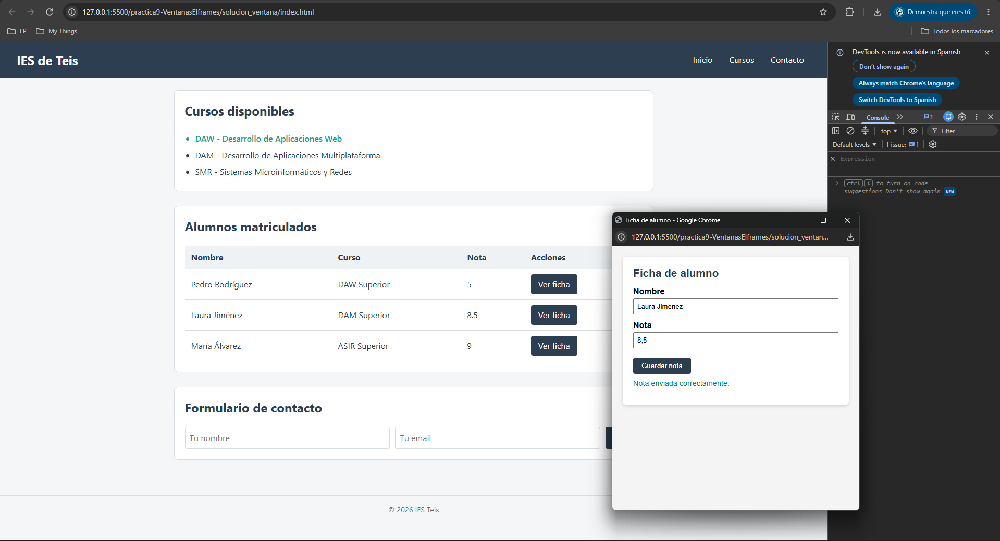
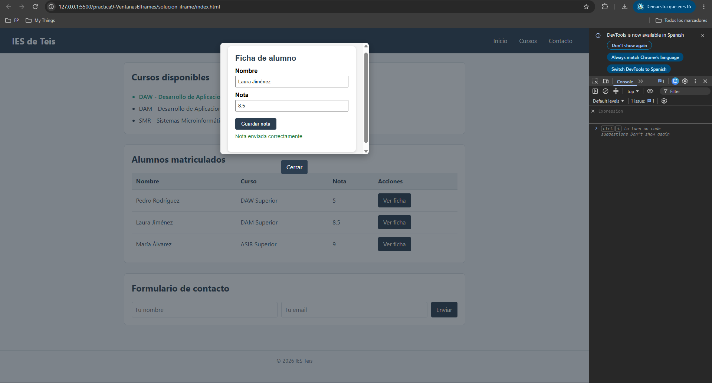
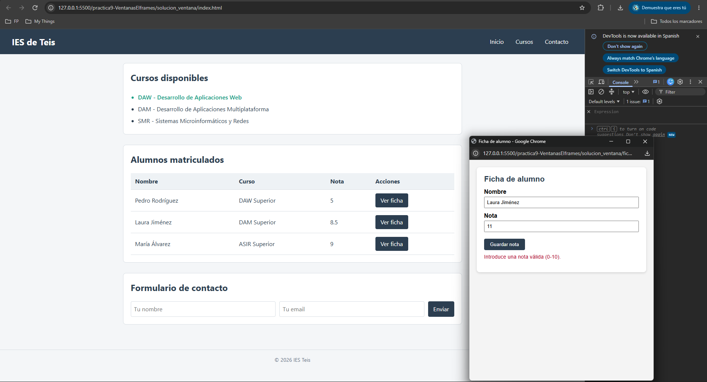

# Práctica 4: ventanas e iframes

Autor/a: Guisande Moreira, Javier

Se abre con Live Server en <http://127.0.0.1:5500>. Cada solución funciona por sí sola:

- `solucion_ventana/index.html`: la ficha se abre en una ventana nueva con `window.open()` y responde a `window.opener`.
- `solucion_iframe/index.html`: la ficha se carga en un `<iframe>` y responde a `window.parent`.

El origen debe ser exactamente `http://127.0.0.1:5500`. Con `file://` no funciona la comprobación del origen y `http://localhost:5500` es otro origen, así que los mensajes no llegarían.

## Pruebas realizadas

| # | Prueba | Parte A (ventana) | Parte B (iframe) |
|---|--------|-------------------|------------------|
| 1 | Se ven las tres filas con «Ver ficha» | OK | OK |
| 2 | La ficha de Laura muestra su nombre y la nota 7 | OK | OK |
| 3 | Guardar 8.5 actualiza la tabla | OK  | OK  |
| 4 | 11 y -1 muestran el mensaje de error | OK  | OK  |
| 5 | Ficha abierta escribiendo la URL | OK | — |
| 6 | El botón «Cerrar» oculta el marco | — | OK |

## Observaciones

- Se comprueba que el campo de la nota no esté vacío antes de convertirlo con `Number`, porque `Number("")` vale `0`. Si está vacío se muestra el mismo aviso que para una nota fuera de rango.
- Al actualizar la tabla también se actualiza la nota en `alumnosIniciales`, de modo que al reabrir la ficha aparece la nota vigente y no la inicial.
- No se han implementado las mejoras opcionales de `window.location.origin` ni el cierre automático tras guardar: se mantiene el origen literal que pide el enunciado y la ventana o el marco siguen abiertos.
- En la parte B, el marco se cierra con el botón «Cerrar», con la tecla `Esc` o haciendo clic en el fondo oscuro. `Esc` funciona también cuando el foco está dentro de la ficha: esta avisa a la página padre con un mensaje `cerrarFicha`.
- La ficha comprueba que existe ventana de origen (parte A) o página padre (parte B) antes de enviar, para no mostrar un envío correcto cuando se abre directamente.
- Los datos se escriben con `textContent`; `innerHTML` solo se usa con la cadena vacía para limpiar el `tbody`.
- La tabla de la parte A muestra las notas actualizadas a través de `postMessage` y la comprobación de `evento.origin`; los mensajes de otros orígenes se ignoran.
